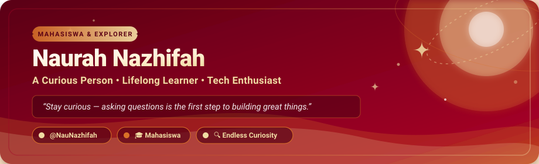

<!-- ===================================================================== -->
<!--  NAURAH NAZHIFAH - GITHUB PROFILE README                              -->
<!--  Palette: #f0dba3 (Cream Sand) | #d97127 (Terracotta) | #a10325 (Crimson) -->
<!-- ===================================================================== -->

<div align="center">

  <!-- Header Banner SVG -->
  

  <br/><br/>

  <!-- Animated Typing SVG -->
  <a href="https://github.com/NauNazhifah">
    
  </a>

  <br/>

  <!-- Quick Badges Row -->
  <p align="center">
    <a href="https://github.com/NauNazhifah">
      
    </a>
    
    
  </p>

  

</div>

<br/>

## 👩‍💻 Tentang Saya *(About Me)*

<div align="center">
  <!-- Terminal Style Portfolio Card -->
  
</div>

<br/>

<details>
<summary><b>🖥️ Klik untuk melihat Biodata Terminal dalam format Teks / JSON</b></summary>
<br/>

```bash
naurah@portfolio:~$ cat biodata.json
```

```json
{
  "nama_lengkap": "Naurah Nazhifah",
  "nama_panggilan": "Nau / Nazhi",
  "status": "Mahasiswa Aktif 🎓",
  "lokasi": "Indonesia 🇮🇩",
  "identitas": "A Curious Person Exploring Technology 🔍",
  "fokus_saat_ini": "Modern Web Development & Dasar Pemrograman 💻",
  "keahlian_teknis": {
    "bahasa_pemrograman": ["HTML5", "CSS3", "JavaScript", "Python"],
    "tools_dan_workflow": ["VS Code", "Git", "GitHub", "Figma", "Notion"]
  },
  "bahasa_komunikasi": ["Bahasa Indonesia (Native)", "English"],
  "filosofi_belajar": "Growth Mindset — konsisten belajar bertahap & tidak ragu bereksplorasi 🌱",
  "minat_eksplorasi": [
    "Frontend Development & Creative Web",
    "UI/UX Design Exploration",
    "Problem Solving & Open Source Collaboration"
  ],
  "bahan_bakar": "Secangkir teh hangat & alunan lo-fi beats ☕",
  "kontak": {
    "email": "naunanazhi@gmail.com",
    "github": "https://github.com/NauNazhifah"
  },
  "motto": "Stay curious — asking questions and exploring possibilities is the first step to building impactful things. ✨"
}
```

</details>

<br/>

<div align="center">
  
</div>

<br/>

## 🎯 Fun Facts *(Hal Menarik & Unik)*

Berikut beberapa hal kecil dan seru tentang keseharian saya:

- ☕ **Bahan Bakar Produktif**: Secangkir teh hangat atau minuman favorit ditemani alunan musik lo-fi saat *coding* atau nugas.
- 🔎 **Curiosity-Driven**: Sering masuk ke *"rabbit hole"* di internet hanya untuk mencari tahu jawaban dari pertanyaan kecil yang bikin penasaran.
- 🧩 **Problem Solver**: Menikmati rasa puas saat berhasil menemukan dan menyelesaikan *error* atau *bug* yang sempat membingungkan.
- 🚀 **Goals**: Mengisi profil GitHub ini dengan karya-karya nyata yang bermanfaat dan rapi dari waktu ke waktu.

<br/>

<div align="center">
  
</div>

<br/>

## 📊 GitHub Analytics *(Statistik GitHub)*

<div align="center">

  <!-- GitHub Readme Stats & Streak Stats in Cohesive Palette (#a10325, #d97127, #f0dba3) -->
  <table border="0">
    <tr align="center">
      <td>
        
      </td>
      <td>
        
      </td>
    </tr>
    <tr align="center">
      <td colspan="2">
        
      </td>
    </tr>
  </table>

</div>

<br/>

<div align="center">
  
</div>

<br/>

## 🛠️ Tech Stack & Minat Eksplorasi

Berikut teknologi dan perangkat yang sedang saya pelajari dan gunakan dalam proyek:

<div align="center">

  <!-- Languages -->
  <p>
    
    
    
    
  </p>

  <!-- Tools & Workflow -->
  <p>
    
    
    
    
    
  </p>

</div>

<br/>

<div align="center">
  
</div>

<br/>

## 📬 Mari Terhubung *(Connect with Me)*

Tertarik untuk berdiskusi, bertukar pengalaman, atau berkolaborasi? Jangan ragu untuk menyapa saya melalui tautan di bawah:

<div align="center">

  <a href="https://github.com/NauNazhifah" target="_blank">
    
  </a>
  &nbsp;
  <a href="mailto:naurah.nazhifah@example.com" target="_blank">
    
  </a>
  &nbsp;
  <a href="https://linkedin.com/in/" target="_blank">
    
  </a>
  &nbsp;
  <a href="https://instagram.com/" target="_blank">
    
  </a>

  <br/><br/>

  <!-- Footer SVG -->
  

</div>
